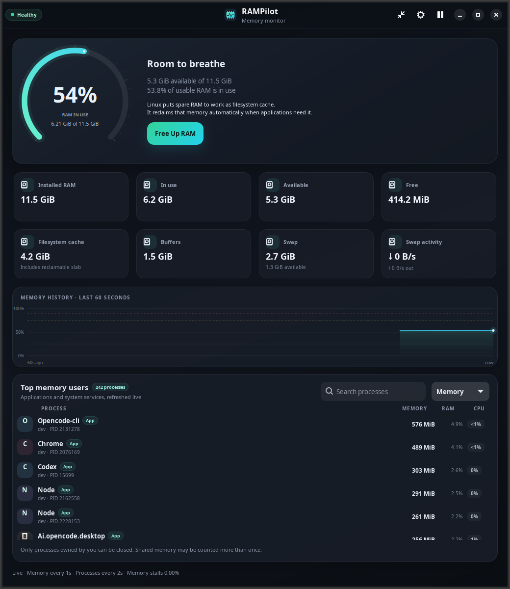
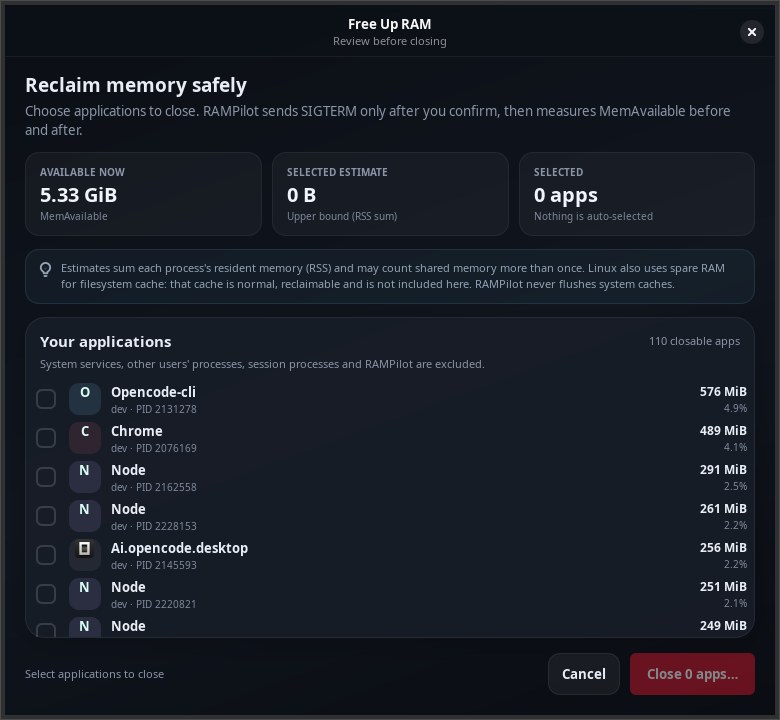
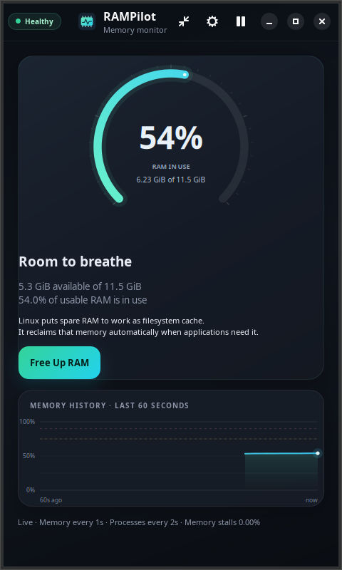
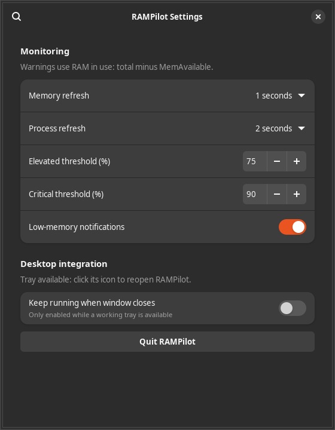

# RAMPilot

A native Linux memory dashboard that helps you understand your RAM and choose
which applications to close. Built with Python, GTK4 and Libadwaita for Ubuntu
24.04+ — with real kernel measurements, a dark desktop interface and no daemon.

[](#dependencies-and-launch)
[](#screenshots)
[](LICENSE)



## What you get

- **Live memory dashboard:** RAM in use, available and free memory, filesystem
  cache, buffers, swap and a large animated usage gauge.
- **60-second history:** a bounded graph with warning thresholds and hover details.
- **Process explorer:** application icons where available, RSS, RAM percentage,
  CPU usage, owners and PIDs, with search and sorting.
- **Deliberate cleanup:** choose processes, review the RSS estimate, confirm
  SIGTERM, and see the measured change in available RAM. Force-close requires
  a separate warning and acknowledgement.
- **Desktop controls:** compact mode, pause/resume, configurable refresh rates,
  low-memory warnings and optional StatusNotifier tray support.

RAMPilot never closes applications automatically, flushes filesystem caches,
installs a service or requires root for monitoring. Linux already reclaims cache
when applications need it; a low “free RAM” number alone is not a problem.

## Screenshots

These are captures of the running GTK application using real system data.
Memory readings and the process list will vary on your machine.

| Review applications before closing | Compact monitoring |
| --- | --- |
|  |  |

<details>
<summary>Monitoring and desktop settings</summary>



</details>

## Dependencies and launch

Use Ubuntu's system Python so it can access the distribution's GTK bindings:

```bash
git clone https://github.com/stevenmcsorley/rampilot.git
cd rampilot
sudo apt update
sudo apt install python3-gi python3-gi-cairo python3-psutil gir1.2-gtk-4.0 gir1.2-adw-1
./bin/rampilot
```

Requires Python 3.10+, GTK4, Libadwaita 1.5+ and Linux 5.3+ with Python's
pidfd support for cleanup. Monitoring does not require pidfds or root.
Ubuntu 22.04's stock Libadwaita is too old. No pip packages, background daemon,
services, elevated monitoring permissions or security changes are required.

## Install in your applications menu

```bash
./install.sh
~/.local/bin/rampilot
```

Installs source and launcher under `~/.local/share/rampilot`, a command in
`~/.local/bin`, and a desktop entry and custom icon in `~/.local/share`.
Launch **RAMPilot** from Applications. Re-run the installer to update.

Uninstall with:

```bash
~/.local/share/rampilot/uninstall.sh
```

This removes its command, menu entry and icon and moves application files to
a uniquely named `~/.local/share/rampilot-uninstalled.*` recovery directory.
Preferences are retained in `$XDG_CONFIG_HOME/rampilot/config.json` (normally
`~/.config/rampilot/config.json`). No system dependencies are removed.

## Ubuntu package

```bash
./packaging/build-deb.sh
sudo apt install ./dist/rampilot_1.0.0_all.deb
# Remove the system package:
sudo apt remove rampilot
```

Choose either the user installer or system package to avoid duplicate launchers.
The package is architecture independent. It uses Ubuntu dependencies and does
not install services. The build script reports its temporary staging location.

## Using RAMPilot

- Monitoring refreshes every second, with process enumeration every two seconds.
  Settings allow 1/2/5-second memory and 2/3/5-second process refresh intervals.
- Search processes by name, command, owner or PID; sort by RAM, CPU, name or PID.
  CPU percentages are per core and can exceed 100% for multithreaded processes.
- Pause stops polling; resume resets rate counters. Compact mode hides the
  process list and detailed tiles while retaining the gauge and graph.
- Elevated and critical indicators default to 75% and 90% in use. Configure
  thresholds and notifications in Settings. Notifications are limited to once
  per five minutes while pressure remains elevated or critical.
- Native StatusNotifier tray integration activates when the desktop provides
  a compatible watcher. Click the icon to reopen the window. Settings permit
  close-to-background only while the tray works, and offer an explicit Quit.
  GNOME normally needs an AppIndicator extension; no extension is installed by
  RAMPilot. Otherwise use the desktop's ordinary Minimise action. If the tray
  disappears, RAMPilot restores the window so it remains reachable.
- Hover the gauge, metrics and processes for memory-accounting explanations.

## Cleanup and safety

**Free Up RAM** presents individual eligible processes in descending RSS order.
Nothing is selected automatically. Review selections and the estimate, confirm
closing applications, then RAMPilot sends SIGTERM and waits up to five seconds.
Only surviving processes can be offered for force-close, with a separate warning,
an acknowledgement checkbox and confirmation before SIGKILL.

Only current-user application processes are eligible. RAMPilot refuses PID 1,
itself and its ancestors, other users, kernel threads, known desktop/session
infrastructure and conservative service categories. This may exclude some
legitimate applications; safety takes priority. Unknown user applications can
still have unsaved work or dependencies, so review them before confirming.
On every action it rechecks ownership, process identity and safety rules. Signals
use Linux pidfds bound to a process instance; cleanup fails safely if pidfds are
unavailable. It never escalates privileges or falls back to racing `kill(pid)`.

Resident memory (RSS) estimates may count shared pages multiple times and do
not guarantee recoverable RAM. The result displays actual MemAvailable before
and after, its measured signed change and process outcomes. Unrelated workloads
can affect this measurement; it is not proof that all the change was caused by
cleanup. No cache flushing, `drop_caches`, root actions or automatic killing.

## Memory accounting

All values are genuine kernel readings, in binary KiB/MiB/GiB units:

| Display | Kernel measurement |
| --- | --- |
| Installed RAM | `MemTotal` (usable physical RAM, excluding hardware reservations) |
| Available | `MemAvailable` |
| In use / gauge | `MemTotal - MemAvailable` |
| Free | `MemFree` |
| Filesystem cache | `Cached + SReclaimable` |
| Buffers | `Buffers` |
| Swap used / available | `SwapTotal - SwapFree` / `SwapFree` |
| Swap activity | Deltas of `/proc/vmstat` `pswpin` / `pswpout`, converted from pages to bytes/second |
| Memory stalls | `/proc/pressure/memory` `some avg10`, where exposed |
| Process RAM | psutil RSS, corresponding to `/proc/PID/statm` resident pages |

Cache and available overlap: the metric tiles are not additive. Linux uses spare
RAM for cache and automatically reclaims it. A small MemFree value alone does not
indicate trouble. `free -h` and different psutil versions may define their `used`
column differently; compare MemAvailable and total directly. Samples taken at
different instants naturally differ. Very old kernels without MemAvailable use
a fallback sum of free, buffers, cache and reclaimable slab.

## Verification

```bash
PYTHONPATH=src /usr/bin/python3 -m unittest discover -s tests -v
PYTHONPATH=src /usr/bin/python3 tests/ui_smoke.py
```

The GTK smoke check requires a desktop display (or `xvfb-run`) and creates its
own disposable memory-allocating process. It checks dashboard startup, settings,
compact/pause, cancellation, SIGTERM survival, separate force confirmation,
SIGKILL and the measured result. It never selects your existing applications.
Core checks cover real `/proc` accounting, RSS agreement, graceful shutdown,
permission-denial handling, disappeared processes, identity mismatch, protected
processes, safe failure without pidfds and bounded history.

Polling and process enumeration use one worker; GTK updates run on the main
loop. Cleanup signalling uses a short-lived worker. History and metadata caches
are bounded, and no polling jobs accumulate while a scan is pending.

See the [validation report](artifacts/VALIDATION.md) for what was exercised and
the limits of the checks, including resource measurements and tray support.

## Project layout

```text
src/rampilot/
  app.py          Application window, settings and asynchronous polling
  cleanup.py      Selection, confirmations and measured cleanup results
  core/           Linux memory readings, process collection and safety rules
  widgets/        Cairo gauge, history graph and process list
  data/           Styles and application icons
  tray.py         Optional D-Bus StatusNotifier integration
bin/              Source and installed launcher
packaging/        Desktop entry and Ubuntu package builder
tests/            Core checks and real GTK cleanup smoke test
docs/screenshots/ Captures of the running application
```

## Contributing

Bug reports and focused pull requests are welcome. Include your distribution,
GTK/Libadwaita versions, launch output and reproduction steps in an
[issue](https://github.com/stevenmcsorley/rampilot/issues).
Run the core checks before submitting changes; changes to cleanup should also
pass the GTK smoke check using disposable processes. Preserve the ownership,
PID identity and explicit-confirmation safeguards.

## License

[MIT](LICENSE) © 2026 Steven McSorley.
